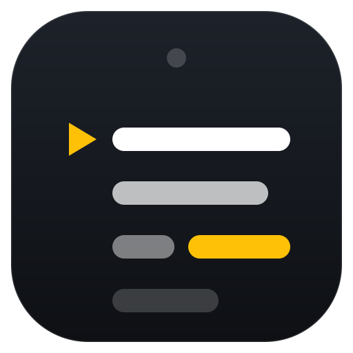
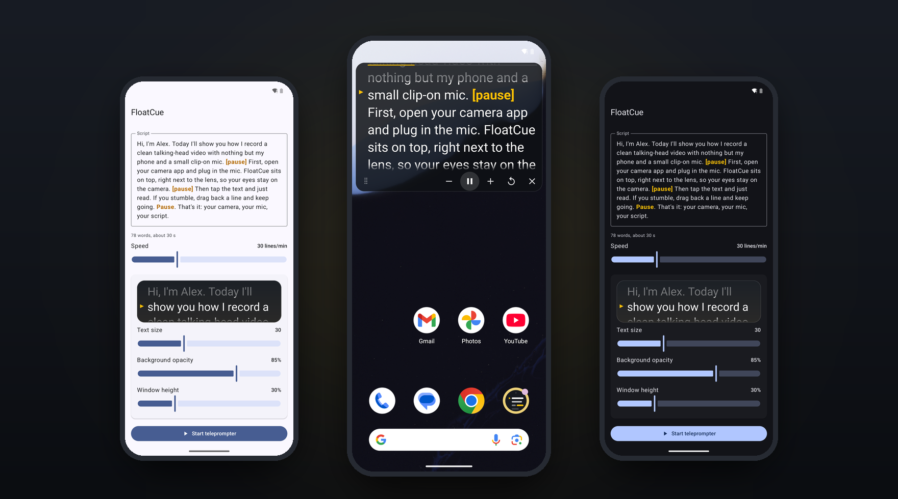
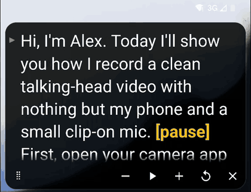

<p align="center">
  
</p>

<h1 align="center">FloatCue</h1>

<p align="center">
  <em>A floating teleprompter for Android.<br>Your camera app. Your microphone. Your script.</em>
</p>

<p align="center">
  <a href="https://github.com/ManuFrauca/floatcue/actions/workflows/ci.yml"></a>
  <a href="LICENSE"></a>
  
  
  
  
</p>

> [!WARNING]
> **Early preview.** FloatCue is at a very early stage (v0.x). Expect bugs and rough edges, and don't rely on it yet for a recording you can't repeat. Settings and behaviour may change between versions. If something breaks, please [open an issue](https://github.com/ManuFrauca/floatcue/issues/new/choose).

<p align="center">
  
</p>

<p align="center">
  <a href="#why">Why</a> &middot;
  <a href="#how-it-works">How it works</a> &middot;
  <a href="#features">Features</a> &middot;
  <a href="#install">Install</a> &middot;
  <a href="#privacy">Privacy</a> &middot;
  <a href="#build-from-source">Build</a>
</p>

---

## Why

Most teleprompter apps record the video themselves. That means their camera, their settings and, very often, the phone's built-in microphone, even when a better mic is plugged in.

FloatCue doesn't record anything. It floats a strip of text over the camera app you already use, right below the front camera, so your eyes stay near the lens. Your camera app records, with every feature it has and the microphone you chose.

| | Teleprompter app that records | FloatCue |
|---|---|---|
| Uses your external mic | Depends on the app | Whatever your camera app uses |
| Camera features (4K, HDR, stabilisation) | The app's own | All of your camera app's |
| Permissions | Camera, microphone, storage | Display over other apps only |
| Sends data anywhere | Varies | Can't: no internet permission |

## How it works

<table>
  <tr>
    <td width="52%" valign="top">
      <h3>1. Write your script</h3>
      <p>Paste or type it. Mark the places where you want to breathe with <code>[pause]</code>.</p>
      <h3>2. Start and open your camera</h3>
      <p>Tap <b>Start teleprompter</b>. FloatCue steps aside and the strip appears at the top of the screen. Open your camera app and hit record.</p>
      <h3>3. Tap the text and read</h3>
      <p>The text scrolls at the pace you set. Tap to pause, drag to go back a line, and use <b>&minus;</b> / <b>+</b> to adjust the speed as you go.</p>
    </td>
    <td width="48%" valign="top">
      
    </td>
  </tr>
</table>

> [!TIP]
> The words `pause` and `pausa` (any case, with or without square brackets) are shown in bold amber, both in the editor and on the strip. Words that only contain them, such as `pauses` or `pausado`, are left alone.

## Features

| Reading | Control | Comfort |
|---|---|---|
| Smooth, time-based scrolling | Tap to play or pause | Strip hides while you edit, then returns where you left off |
| Speed in lines per minute (10&ndash;80) | Drag the text to go back or forward | Adjustable text size, opacity and height |
| Amber caret marks the reading line | Slower, faster, restart, close | Text shadow and soft edges for any background |
| Highlighted `[pause]` markers | Play, pause and stop from the notification | TalkBack support, including moving the strip |
| Sits below the camera cutout | Drag the grip to move the strip | Everything saves automatically |

Portrait only. Touches outside the strip go straight to the app underneath, so the shutter button keeps working.

## Install

Requires Android 8.0 or newer. Developed and tested for a Pixel 8 Pro on Android 16.

1. Download the APK from [Releases](https://github.com/ManuFrauca/floatcue/releases).
2. Check that its SHA-256 matches the one in the release notes:
   ```sh
   shasum -a 256 floatcue-*.apk
   ```
3. Install it and open FloatCue. It asks for **Display over other apps** and takes you to the right settings screen.

> [!IMPORTANT]
> On Android 15 and newer, apps installed from outside an app store may find that toggle greyed out. Open **App info** for FloatCue, tap the **&#8942;** menu, choose **Allow restricted settings**, and try again.

## Privacy

FloatCue has no internet permission, so it cannot send your script anywhere. Your script stays on your phone:

- It is not included in Google's cloud backup. It does move to a new phone if you use device-to-device transfer.
- It is hidden from the recent-apps thumbnail.
- It is never logged and never shown in the notification.

| Permission | Why FloatCue needs it |
|---|---|
| Display over other apps | To draw the strip on top of your camera app |
| Foreground service (special use) | To keep the strip alive while another app is in front |
| Notifications | For the Play/Pause and Stop buttons in the notification |

Found a security problem? See [SECURITY.md](SECURITY.md).

## Build from source

You need JDK 21 and the Android SDK (platform 37).

```sh
./gradlew lint testDebugUnitTest assembleDebug
adb install app/build/outputs/apk/debug/app-debug.apk
```

<details>
<summary><b>Signed release builds</b></summary>

<br>

Create your own keystore and describe it in `keystore.properties` at the repository root. The file is gitignored.

```properties
storeFile=/path/to/floatcue.jks
storePassword=...
keyAlias=...
keyPassword=...
```

You can use the environment variables `FLOATCUE_KEYSTORE`, `FLOATCUE_KEYSTORE_PASSWORD`, `FLOATCUE_KEY_ALIAS` and `FLOATCUE_KEY_PASSWORD` instead. Then run `./gradlew assembleRelease`. The APK is written to `app/build/outputs/apk/release/app-release.apk`. Without a key, the release build is unsigned.

</details>

<details>
<summary><b>Project layout</b></summary>

<br>

```text
app/src/main/kotlin/io/github/manufrauca/floatcue/
├── MainActivity.kt      settings screen (Compose, Material 3)
├── OverlayService.kt    foreground service that owns the floating strip
├── PrompterView.kt      scrolling text, reading caret, touch handling
├── PrompterMath.kt      speed, progress and position maths (unit-tested)
├── PauseHighlighter.kt  finds [pause] / pausa markers (unit-tested)
└── Prefs.kt             settings and script, stored on the device
```

</details>

## Contributing

Issues and pull requests are welcome. Read [CONTRIBUTING.md](CONTRIBUTING.md) first: FloatCue is deliberately small, so the bar for new features is high and the bar for bug fixes is low.

## License

[GPL-3.0](LICENSE). You can use, study, change and share FloatCue. If you distribute a modified version, it must stay open source under the same licence.
